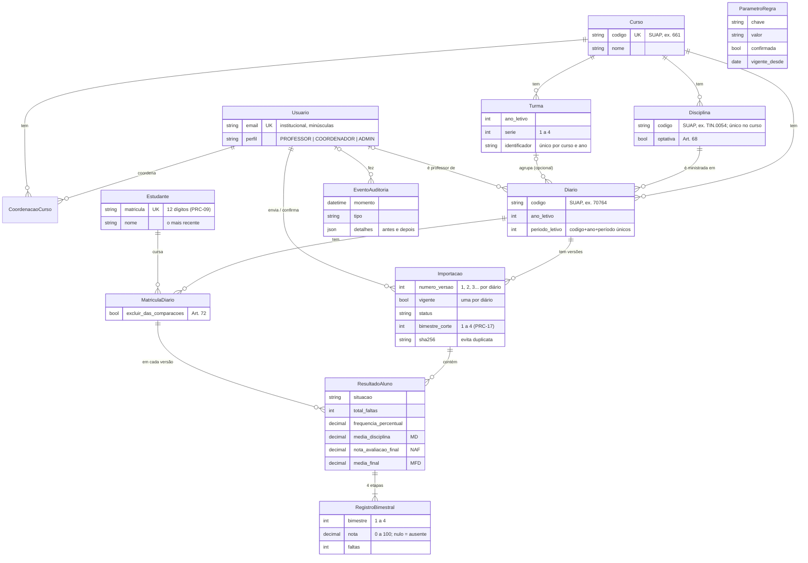

# Modelo de dados (E2)

Diagrama entidade-relacionamento do SUAP V2 após a E2. As caixas trazem só os campos principais; a definição completa está nos `models.py` de cada app.

## Regras que o banco garante

| Regra | Como |
|---|---|
| Nada é sobrescrito (IDs 6 e 19) | Cada boletim importado vira uma `Importacao`. Depois de confirmada, ela e as notas dela não mudam nem somem: o modelo recusa, e gatilhos no PostgreSQL (`notas/0002`) barram `UPDATE` e `DELETE`. Só o campo `vigente` pode mudar. |
| Uma versão vigente por diário | Índice único parcial (`diario` onde `vigente = true`), e vigente só se confirmada (`CHECK`). |
| Notas de 0 a 100 (RN-01) | `CHECK` em nota, MD, NAF, MFD e % de frequência; nulo = ausente, não zero. |
| Bimestre de 1 a 4 (RN-19) | `CHECK` no registro e no bimestre de corte. |
| Sem duplicatas | Códigos do SUAP únicos (curso; disciplina no curso; diário no ano e período; matrícula); mesmo SHA-256 no mesmo diário é recusado. |
| Coerência do diário | Disciplina e turma do mesmo curso e ano do diário; professor ativo com perfil Professor ou Coordenador (validação do modelo). |
| Auditoria só de inclusão (ID 13) | Gatilho em `auditoria_eventoauditoria` (`auditoria/0002`). |

## Por que a turma é opcional

O boletim do SUAP traz curso, diário e disciplina, mas não a turma. O diário criado a partir de um boletim fica sem turma, até a coordenação ou a administração vincular (tela "Editar diário").
